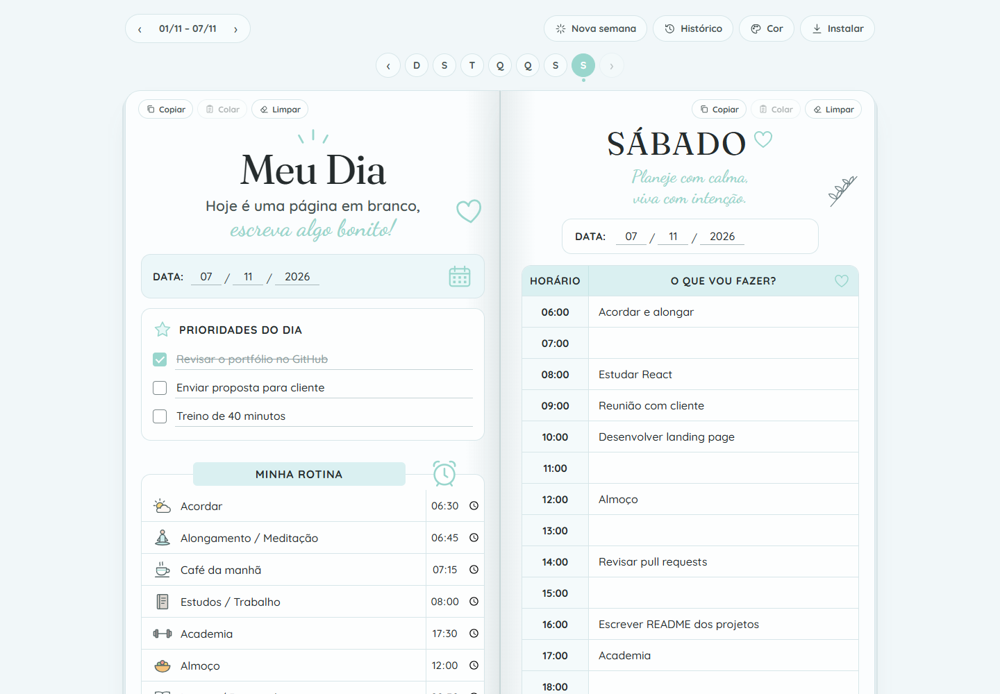
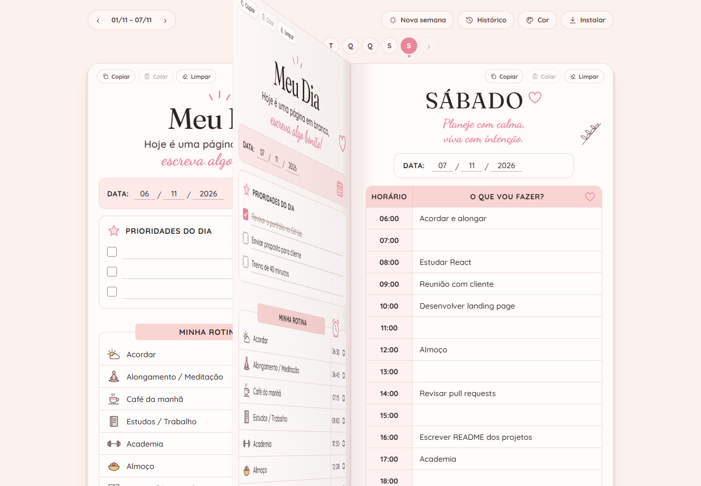
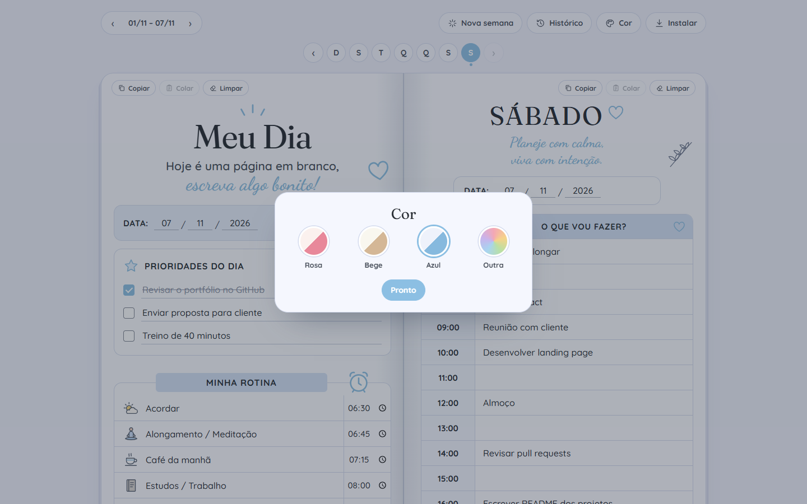
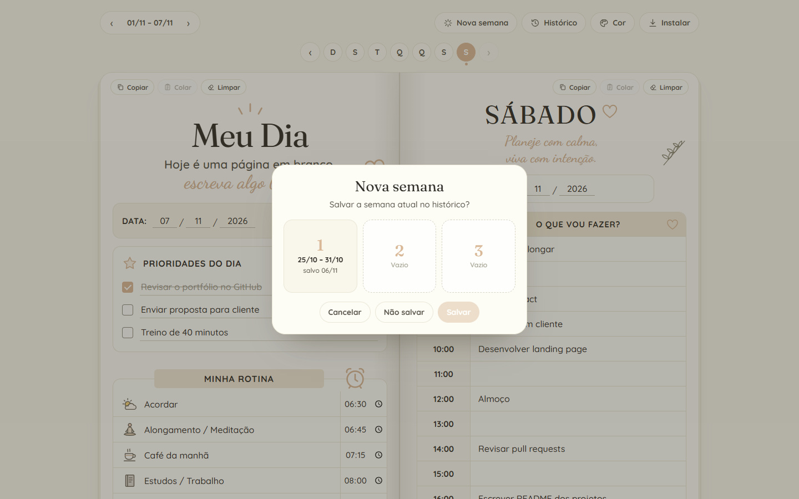
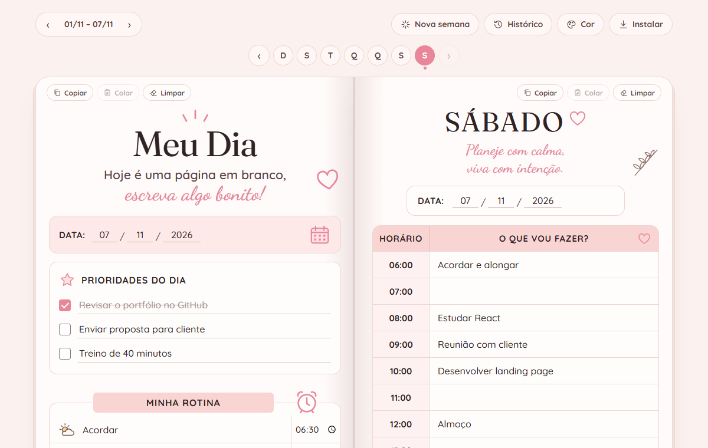
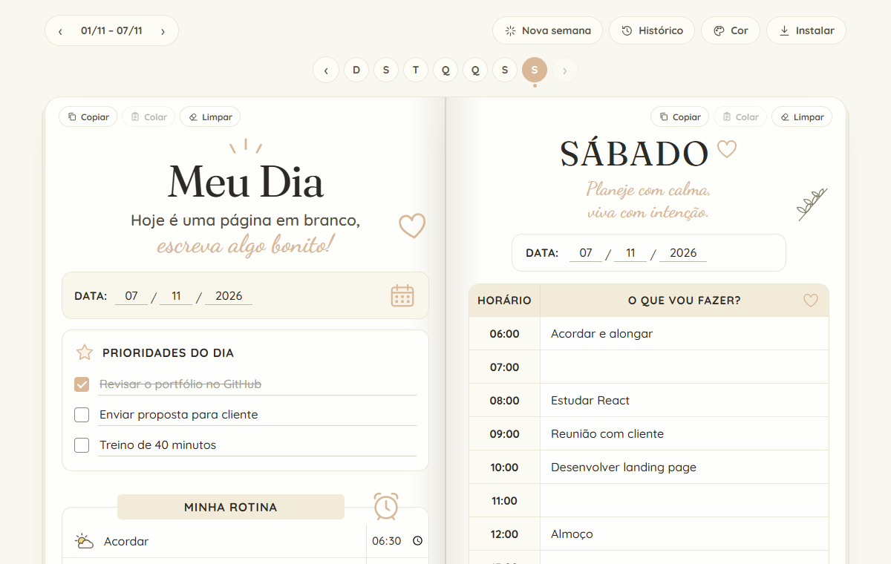
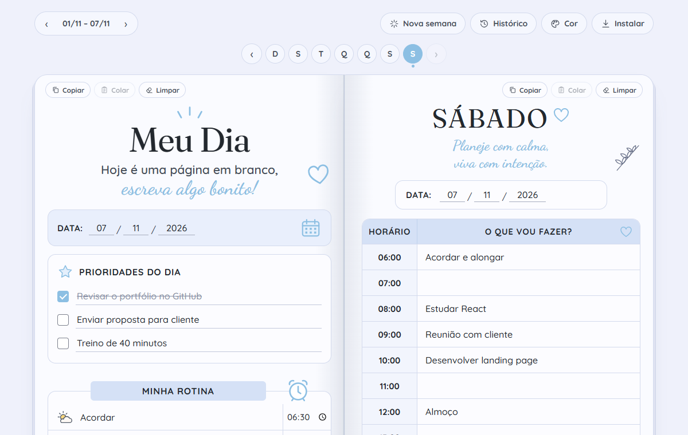
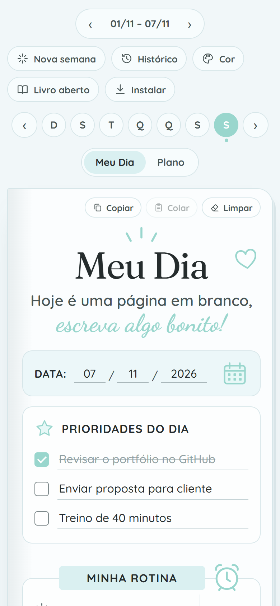
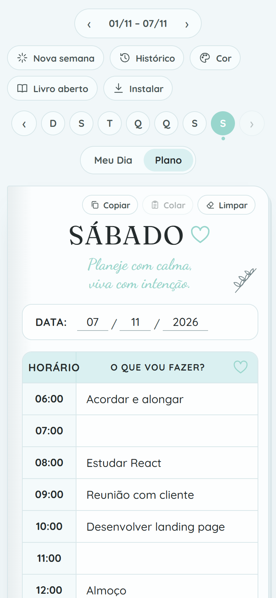
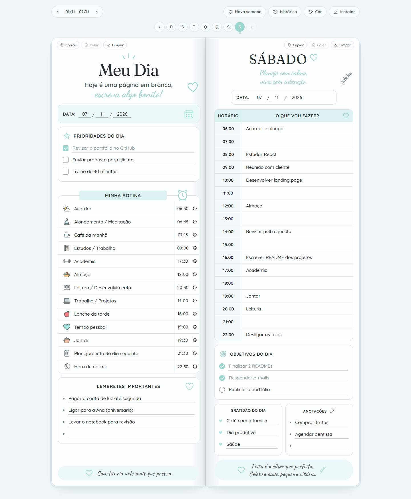

<div align="center">


# Organiza Garota

Planner semanal em formato de livro aberto: de um lado, **Meu Dia**; do outro, **Plano do Dia**.<br>
Com virada de página em 3D, temas de cor, instalação como app e funcionamento offline.


### [🔗 Acesse online: organizagarota.netlify.app](https://organizagarota.netlify.app)

</div>



## Sobre

O Organiza Garota mantém a sensação de folhear um planner de papel, com páginas que viram de verdade, e soma as vantagens de um app: copiar o planejamento de um dia para outro, guardar semanas anteriores e usar no celular sem internet.

O app inteiro é **HTML, CSS e JavaScript puros**, sem framework, sem biblioteca e sem etapa de build. As ilustrações são SVGs escritos à mão dentro do código.

## Funcionalidades

**Meu Dia (página esquerda)**
- Prioridades do dia com caixa de seleção; o item concluído fica riscado
- Rotina com 13 atividades, cada uma com horário e ícone que podem ser trocados
- Lembretes importantes

**Plano do Dia (página direita)**
- Agenda de hora em hora, das 06:00 às 22:00
- Objetivos do dia, gratidão e anotações

**Organização da semana**
- Navegação pelos dias (D S T Q Q S S), pelas setas do teclado ou arrastando a página com o dedo ou o mouse
- Datas preenchidas automaticamente a partir da semana atual
- **Copiar, colar e limpar** uma página inteira (por exemplo, repetir a rotina de segunda na terça), com confirmação antes de sobrescrever
- **Nova semana:** guarda a semana atual em um dos 3 espaços do histórico, mantém os nomes e ícones da rotina e limpa o resto
- **Histórico:** restaura ou exclui semanas salvas

**Personalização e uso**
- Temas Rosa, Bege e Azul, ou qualquer cor escolhida no seletor
- Instalável como app no celular e no computador, e funciona offline

## Telas

<table>
  <tr>
    <td width="50%"><br><sub><b>Virada de página em 3D</b>: a folha acompanha o arraste</sub></td>
    <td width="50%"><br><sub><b>Temas</b>: três paletas prontas ou qualquer cor</sub></td>
  </tr>
  <tr>
    <td width="50%"><br><sub><b>Nova semana</b>: escolha onde guardar a semana atual</sub></td>
    <td width="50%">
      
      
      <br>
      <sub><b>Rosa, Bege e Azul</b>: a paleta inteira muda junto</sub>
    </td>
  </tr>
</table>

<p align="center">
  &nbsp;&nbsp;
  <br>
  <sub>No celular, uma página por vez, com abas para alternar entre Meu Dia e Plano</sub>
</p>

<details>
<summary>Ver o livro aberto inteiro</summary>



</details>

<sub>Os dados nas imagens são exemplos.</sub>

## Destaques técnicos

- **Virada de página em 3D:** cada folha é montada com duas faces (`backface-visibility`) e girada com `rotateY` dentro de um container com `perspective`. A animação usa `requestAnimationFrame` com *easing* cúbico, e uma sombra acompanha o ângulo da folha.
- **Arrastar para folhear:** com Pointer Events, a folha segue o dedo ou o mouse. Ao soltar, ela completa a virada se passou de 28% do caminho; se não, volta. O gesto vertical continua rolando a página normalmente.
- **Temas gerados por cor:** a paleta é definida em HSL. Cada cor guarda a própria luminosidade, e o tema só gira o matiz e ajusta a saturação. Por isso qualquer cor do seletor gera uma paleta inteira coerente. O tema é aplicado antes da primeira pintura da tela, sem "piscar".
- **Layout responsivo:** a partir de 900 px de largura, o livro aparece aberto com duas páginas. No celular, aparece uma página por vez com abas, ou o livro aberto com rolagem lateral, se a pessoa preferir.
- **PWA offline:** manifest e service worker com duas estratégias de cache. As páginas buscam primeiro a versão mais nova e usam a guardada sem internet. Ícones e fontes saem do cache e são atualizados em segundo plano.
- **Dados salvos no aparelho:** tudo fica no `localStorage`. A gravação espera 250 ms depois da última digitação e é forçada ao fechar ou esconder a aba. Uma migração converte automaticamente os dados do formato antigo do app.
- **Acessibilidade:** rótulos `aria` nos campos e botões, janelas com `role="dialog"`, avisos lidos por leitores de tela (`aria-live`) e atalhos de teclado (setas trocam o dia, `Esc` fecha janelas).

## Estrutura

```
minha-rotina/
├── index.html             # o app inteiro: estrutura, estilos e lógica
├── sw.js                  # service worker (funcionamento offline)
├── manifest.webmanifest   # nome, cores e ícones para instalar como app
└── icon-*.png             # ícones do app
```

## Como rodar

Não há nada para instalar. Basta abrir `minha-rotina/index.html` no navegador.

Para testar a instalação e o modo offline, o app precisa ser servido por HTTP:

```bash
npx serve minha-rotina
# ou
python -m http.server 8080 --directory minha-rotina
```

Para publicar, envie a pasta `minha-rotina/` para qualquer hospedagem estática. A versão online está na [Netlify](https://organizagarota.netlify.app).

## Autora

Feito por **Talia Lino**: [LinkedIn](https://www.linkedin.com/in/talia-lino-de-oliveira/) · [GitHub](https://github.com/talialino)
